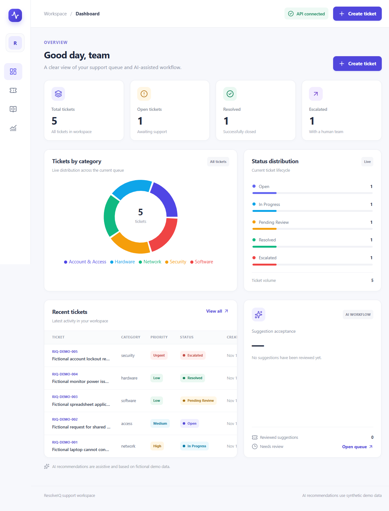
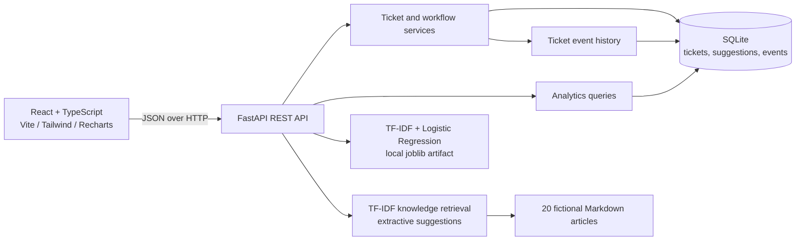

# ResolveIQ

**AI-assisted IT support ticketing with human-controlled resolutions.**

ResolveIQ is a portfolio MVP that demonstrates how an IT support team can capture requests, triage them consistently, find relevant troubleshooting guidance, and keep a human in control of resolution decisions. It is an educational demo, not a production-ready service.

## The problem and business use case

Enterprise help desks receive requests through multiple channels, often with incomplete details and inconsistent prioritization. A support engineer needs to classify and route each request, search internal runbooks, document decisions, and maintain an auditable ticket lifecycle.

ResolveIQ models that workflow for a fictional company's IT service desk. It combines conventional CRUD and audit history with advisory classification and source-linked knowledge retrieval. The application does not execute suggested commands or let an AI recommendation resolve a ticket.

## Implemented features

- Create, search, filter, paginate, update, and track IT tickets.
- Validate ticket transitions and record ticket, escalation, suggestion, and review events.
- Classify a ticket with a locally trained TF-IDF/logistic-regression pipeline; show confidence and manual-review guidance.
- Recommend a support team deterministically and recommend priority using transparent rules.
- Search 20 fictional Markdown knowledge articles with ranked chunks, raw cosine scores, document IDs, and source references.
- Generate extractive troubleshooting suggestions with evidence warnings and a safe insufficient-evidence fallback.
- Persist suggestions and let a fictional demo reviewer accept, edit, or reject them. Suggestion review never resolves a ticket.
- Escalate tickets to a human support team and view SQLite-backed dashboard and analytics.
- Use a React/Vite interface connected to the FastAPI API; there are no mock metric responses.

## Application preview



The screenshot is from the local application and uses only fictional seed tickets. The AI acceptance metric is empty until a suggestion is reviewed.

## Architecture



See [docs/ARCHITECTURE.md](docs/ARCHITECTURE.md) for component responsibilities and workflow details.

## Technology

| Area | Technologies |
| --- | --- |
| Backend | Python 3.12, FastAPI, Pydantic, SQLAlchemy |
| Persistence | SQLite |
| Classification | scikit-learn, pandas, TF-IDF, Logistic Regression |
| Knowledge retrieval | scikit-learn TF-IDF, cosine similarity, extractive steps |
| Frontend | React, TypeScript, Vite, Tailwind CSS, React Router, Recharts, Lucide |
| Testing | Pytest, FastAPI TestClient, frontend lint and production build |

## Prerequisites

- Windows 10/11 with PowerShell.
- Python 3.12 and the Python launcher (`py`).
- Node.js 22.12 or newer (Vite also supports Node 20.19 or newer) and npm.
- Git.

No paid API key or external AI service is required. The classifier artifact is created locally by the training script.

## Setup on Windows PowerShell

Run commands from the repository root. To avoid PowerShell execution-policy issues, the commands call the virtual-environment Python executable directly rather than activating it.

```powershell
py -3.12 -m venv .venv
.\.venv\Scripts\python.exe -m pip install --upgrade pip
.\.venv\Scripts\python.exe -m pip install -r backend\requirements.txt
Copy-Item .env.example .env
.\.venv\Scripts\python.exe scripts\train_ticket_classifier.py
```

The training step writes the model under `backend\app\ai\artifacts\`. The artifact is ignored by Git and is not trained when API requests arrive.

### Optional fictional seed tickets

In the same PowerShell window, from the repository root:

```powershell
.\.venv\Scripts\python.exe scripts\seed_tickets.py
```

Seeding is idempotent by ticket number. It creates five fictional tickets with reserved `example.com` addresses. For a separate local database, set `DATABASE_URL` before running the seeder and the backend, for example:

```powershell
$env:DATABASE_URL = "sqlite:///./resolveiq-demo.db"
.\.venv\Scripts\python.exe scripts\seed_tickets.py
```

Keep the same environment variable in the backend terminal so both commands use the same database.

## Run the application

### Backend

From the repository root:

```powershell
.\.venv\Scripts\python.exe -m uvicorn app.main:app --app-dir backend --reload
```

- Health: <http://127.0.0.1:8000/api/health>
- Interactive Swagger UI: <http://127.0.0.1:8000/docs>
- OpenAPI JSON: <http://127.0.0.1:8000/openapi.json>

### Frontend

Open a second PowerShell terminal:

```powershell
Set-Location frontend
npm ci
Copy-Item .env.example .env.local
npm run dev
```

Open <http://localhost:5173>. `npm ci` installs the exact dependency tree recorded in `frontend\package-lock.json`. `npm run lint` and `npm run build` validate the frontend.

## Environment configuration

Backend settings are read from root `.env` and can also be supplied as environment variables:

| Setting | Default | Description |
| --- | --- | --- |
| `APP_NAME` | `ResolveIQ API` | FastAPI application title |
| `DEBUG` | `false` | Development diagnostics; keep disabled for deployments |
| `DATABASE_URL` | `sqlite:///./resolveiq.db` | SQLAlchemy database URL |
| `CORS_ORIGINS` | `["http://localhost:5173","http://127.0.0.1:5173"]` | Allowed frontend origins |

The frontend reads `VITE_API_BASE_URL` from `frontend\.env.local`; the default is `http://127.0.0.1:8000/api`. The checked-in `.env.example` files contain local defaults only. Never put credentials or private data in example files.

## AI and knowledge base

### Ticket classification

The local model is a scikit-learn pipeline: word-level TF-IDF with unigrams/bigrams followed by Logistic Regression. It returns one of Hardware, Software, Network, Account & Access, Security, or Other. A deterministic category-to-team map and substring-based impact rules provide separate recommendations; priority is not a trained prediction. The classifier's probability is not calibrated and low confidence requests manual review.

The checked-in dataset has 108 generated fictional records. The documented evaluation is accuracy **1.0000** and macro F1 **1.0000** on 27 held-out synthetic examples (81 training examples), using a grouped split and a cross-split near-duplicate check. These results describe only this generated dataset; they are not real-world performance claims. See [docs/AI_CLASSIFICATION.md](docs/AI_CLASSIFICATION.md) and [docs/AI_CLASSIFICATION_EVALUATION.json](docs/AI_CLASSIFICATION_EVALUATION.json) for the full protocol and confusion matrix.

### Knowledge retrieval and suggestions

Twenty fictional Markdown articles are chunked deterministically and indexed with TF-IDF. Search ranks chunks by cosine similarity and returns source attribution; similarity is a raw score, not a probability. The default resolution suggestion extracts numbered/list guidance from retrieved chunks. Weak retrieval returns insufficient evidence and no troubleshooting steps. Suggestions always require human review; privileged account/security work requires authorized human handling.

## API and walkthroughs

- [API reference](docs/API_REFERENCE.md) — endpoints, fields, transitions, and example payloads.
- [Demo guide](docs/DEMO_GUIDE.md) — a presenter-oriented walkthrough using fictional data.
- [Architecture](docs/ARCHITECTURE.md) — system diagram, components, and data flows.
- [Integration report](docs/INTEGRATION_REPORT.md) — manually verified browser/API flows.
- [Quality report](docs/QUALITY_REPORT.md) — tests, audit findings, limitations, and production gaps.
- [Final portfolio QA report](docs/FINAL_REPORT.md) — acceptance checklist, current verification, launch commands, and demo/presentation material.

## Tests

From the repository root:

```powershell
.\.venv\Scripts\python.exe -m pytest backend\tests -q
Set-Location frontend
npm run lint
npm run build
```

## Limitations and future improvements

- No authentication or role-based authorization; demo actor/reviewer labels are attribution only.
- Synthetic data only; validate with representative, authorized, privacy-reviewed data before drawing operational conclusions.
- SQLite and `create_all` are suitable for this local MVP, not a substitute for production migrations, backup, or concurrency planning.
- No request rate limiting, production monitoring, alerting, or formal data retention controls.
- The frontend and backend have no automated browser end-to-end suite; integration flows were manually exercised.
- Potential next steps: authentication/RBAC, database migrations and a production database, secure deployment controls, automated E2E tests, and a documented evaluation/calibration process.

This repository is a portfolio demonstration and is **not production-ready**.

## License

No `LICENSE` file is currently included. Do not infer open-source reuse rights until the repository owner selects and adds a license.
