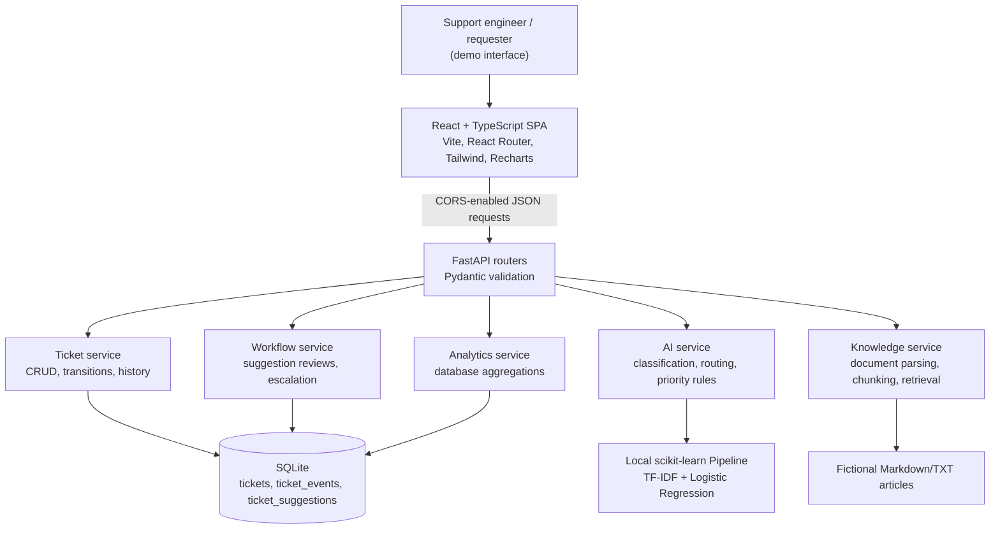

# ResolveIQ Architecture

ResolveIQ is a local-first support workflow demo. The React client calls a FastAPI JSON API; the backend owns ticket state, AI inference/retrieval, audit events, and analytics.

## Component diagram



## Responsibilities

- **Frontend:** Presents ticket creation/list/detail, analysis preview, sourced suggestions, human-review controls, escalation, knowledge search, and current database metrics. It does not contain canonical ticket state or fake metrics.
- **API and schemas:** `backend/app/api/` maps HTTP routes to services. Pydantic schemas validate input lengths/enums and shape responses. There is no authentication in this MVP.
- **Ticket service:** Applies CRUD operations, validates status transitions, sets server timestamps/IDs, and appends ticket events in a SQLAlchemy transaction.
- **Workflow service:** Persists generated suggestions, enforces terminal human-review decisions, records reviewer/audit data, and escalates eligible tickets to enumerated human teams.
- **AI service:** Loads a locally trained model once per process, reports the classifier's actual predicted-class probability, maps categories to teams, and derives priority from documented text rules. It does not mutate ticket fields.
- **Knowledge service:** Loads only repository-local Markdown/TXT articles, parses metadata, redacts common secret patterns, chunks longer content deterministically, and ranks chunks with cosine similarity over TF-IDF vectors. Its default provider is extractive; retrieved instructions are never executed.
- **Analytics service:** Computes counts/groupings and resolution/review metrics from SQLite. Undefined averages/rates are null.
- **Persistence:** SQLAlchemy models link `Ticket` to `TicketEvent` and `TicketSuggestion` with bidirectional relationships. Mutating service operations use transaction scopes to keep state and audit changes together.

## Request and data flow

```mermaid
sequenceDiagram
    actor Engineer
    participant UI as React UI
    participant API as FastAPI
    participant AI as AI / Knowledge services
    participant DB as SQLite

    Engineer->>UI: Enter ticket details
    UI->>API: POST /api/tickets
    API->>DB: Insert ticket + created event atomically
    DB-->>API: Persisted ticket
    API-->>UI: Ticket ID, ticket number, timestamps
    Engineer->>UI: Request optional AI analysis
    UI->>API: POST /api/ai/analyze-ticket
    API->>AI: Predict category; calculate rules-based priority
    AI-->>UI: Recommendation + confidence + manual-review flag
    Note over UI,DB: Analysis does not write or overwrite ticket fields
    Engineer->>UI: Request resolution suggestion
    UI->>API: POST /api/tickets/{id}/suggestions
    API->>AI: Retrieve evidence and extract cited steps
    AI-->>API: Suggestion, sources, warning
    API->>DB: Store pending suggestion + audit event atomically
    Engineer->>UI: Accept, edit, reject, or escalate
    UI->>API: Human review/escalation request
    API->>DB: Persist decision/state + audit event atomically
```

## State and safety boundaries

- Ticket IDs, ticket numbers, and timestamps are server controlled.
- Allowed ticket statuses are `open`, `in_progress`, `pending_review`, `resolved`, and `escalated`. `resolved` is terminal.
- A suggestion is informational until reviewed; acceptance/editing never automatically resolves a ticket.
- Knowledge scores are raw cosine similarities, not calibrated confidence values.
- A low classifier confidence or weak knowledge match is surfaced for human review; weak retrieval produces no steps.
- Actor and reviewer values are fictional demo labels, not authenticated identity claims.

## Local runtime

The backend defaults to `sqlite:///./resolveiq.db`; its location is relative to the process working directory. FastAPI creates tables at startup using SQLAlchemy metadata. The classifier artifact is generated under `backend/app/ai/artifacts/` and ignored by Git. The knowledge index is cached in-process; restart the backend after changing article files.

## Production evolution

A production design would add authentication and RBAC, TLS, a migration system, a managed database, controlled secret management, observability, backups, rate limits, and deployment-specific CORS. Larger document collections could use a separately managed search/vector index and background indexing. Model evaluation, versioning, calibration, privacy, and human oversight would require an explicit governance process.
