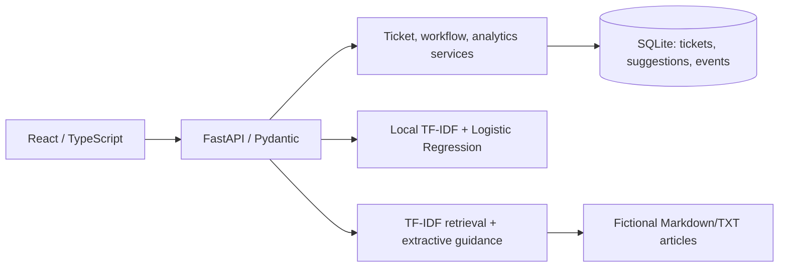

# ResolveIQ Final Portfolio QA Report

**Review date:** 2026-11-14
**Readiness decision:** **PASS for a local internship portfolio demonstration. Not production-ready.**

This review reran the backend and frontend checks and exercised the running React application against FastAPI using an isolated SQLite database. The live records were fictional. Results below describe this local review session and do not imply production usage.

## Final acceptance checklist

| Checklist item | Result | Evidence |
| --- | --- | --- |
| Backend starts successfully | **PASS** | Started Uvicorn with the README application module and an isolated `DATABASE_URL`; `/api/health` returned `{"status":"ok"}`. |
| Frontend starts successfully | **PASS** | Vite returned HTTP 200; the browser loaded the dashboard and showed “API connected.” |
| API health check works | **PASS** | Live `GET /api/health` returned HTTP 200 and `{"status":"ok"}`. |
| New ticket can be created | **PASS** | Submitted a fictional ticket through the React form; FastAPI returned the saved ticket and navigated to its details page. |
| Ticket appears in database | **PASS** | Queried the isolated SQLite file directly; the React-created ticket was present. The database held two tickets after the API workflow checks. |
| Ticket filters and search work | **PASS** | Browser search combined with the escalated status filter narrowed the list to one matching ticket; backend tests also cover pagination and combined filters. |
| AI classification returns actual predictions | **PASS** | The locally persisted model returned `Network` for the fictional VPN request, with observed confidence `0.2195` and manual review requested. |
| Routing recommendations work | **PASS** | The same classification recommended `Network Support`; the deterministic category/team mapping is covered by tests. |
| Knowledge retrieval returns relevant sources | **PASS** | VPN search returned a reliable match including `KB-NETWORK-003` and `KB-NETWORK-004`; the browser displayed document IDs, source references, and raw cosine scores. |
| Suggested resolution can be reviewed | **PASS** | Generated and saved a source-attributed suggestion in the UI; the UI exposed review controls and showed the saved decision and audit history. |
| Approval and rejection persist correctly | **PASS** | Accepted a supported suggestion and rejected an insufficient-evidence suggestion through the UI. API reads and SQLite-backed analytics showed the decisions persisted; neither action resolved a ticket. |
| Escalation works | **PASS** | Escalated the fictional VPN ticket to `Network Support`; API and UI showed the `escalated` state and new assignment. |
| Ticket history updates correctly | **PASS** | History showed ticket creation, suggestion generation, review decisions, team reassignment, status change, and escalation events with demo actor labels. |
| Dashboard metrics reflect database state | **PASS** | Dashboard showed 2 tickets, 1 open, 1 escalated, and a 50% suggestion acceptance rate from 4 reviewed decisions (2 accepted, 2 rejected). The API returned `null` for average resolution time because no ticket was resolved. |
| Backend tests pass | **PASS** | `.\.venv\Scripts\python.exe -m pytest backend\tests -q` — **76 passed**, with one existing Starlette/httpx TestClient deprecation warning. |
| Frontend production build passes | **PASS** | `npm run lint` passed; `npm run build` passed TypeScript checks and Vite production bundling. |
| README includes working startup instructions | **PASS** | Prerequisite versions, scripts, environment templates, backend/frontend commands, and local paths were checked. The backend and frontend were started locally using those entry points. |
| Synthetic-data limitations are documented | **PASS** | README and AI documentation label the results as synthetic. The evaluation reports 1.0000 accuracy and macro F1 on 27 held-out generated examples and explicitly disclaims real-world performance. |
| No secrets are committed | **PASS, bounded check** | No local `.env`, database, or model artifact is tracked. A scan for common API-key/private-key patterns found no matches. This was not a comprehensive secret-history scan. |
| Git repository is ready for publishing | **PASS** | The configured public remote responds to `git ls-remote`; the application and documentation commit were pushed to branch `main`. The local worktree was clean before this report was added. |

## Implemented features verified

- Ticket create/list/search/filter/pagination, detail/update, status transitions, and ticket history.
- Server-generated ticket IDs/ticket numbers/timestamps and transactional audit events.
- A locally loaded TF-IDF and Logistic Regression classifier, category-to-team routing, and transparent rules-based priority suggestions.
- A TF-IDF knowledge search over fictional Markdown articles, with source attribution, raw cosine scores, and insufficient-evidence fallback.
- Persisted, human-reviewable suggestions with accept/edit/reject decisions; suggestion review does not resolve a ticket.
- Human-team escalation and database-backed analytics.
- React pages for dashboard, tickets, ticket creation/details, knowledge search, and analytics, connected to the live API.

## Test commands and results

From the repository root in PowerShell:

```powershell
.\.venv\Scripts\python.exe -m pytest backend\tests -q
Set-Location frontend
npm run lint
npm run build
```

Results: **76 backend tests passed**; frontend lint and production build passed. Pytest emitted one pre-existing Starlette/httpx TestClient deprecation warning.

Live integration checks used a separate `portfolio-final-qa-20261114.db` file. They covered ticket creation from the browser, direct SQLite persistence, filtering/search, actual model inference, routing, knowledge retrieval, suggestion acceptance and rejection, escalation, history, and analytics. The temporary database was removed after verification.

## Verified metrics

### Synthetic classifier evaluation

The committed evaluation is for synthetic data only: 108 generated records; a scenario-grouped split of 81 training and 27 held-out records; accuracy **1.0000** and macro F1 **1.0000** on the held-out synthetic set. The data is small and templated, and no real-world accuracy claim is supported.

### Isolated live workflow run

- Tickets: **2 total**, **1 open**, **1 escalated**, **0 resolved**.
- Suggestions: **4 reviewed**, comprising **2 accepted** and **2 rejected**.
- Acceptance rate: **50%**, calculated as `(accepted + edited) / (accepted + edited + rejected)`.
- Average resolution time: **N/A (`null`)**, because the isolated run had no resolved tickets.
- Live VPN classifier response: category **Network**, confidence **0.2195**, team **Network Support**, and manual review requested. The confidence is the model's uncalibrated predicted-class probability.

These are observed local test values, not performance or business-impact measurements.

## Technology stack

- Python 3.12, FastAPI, Pydantic, SQLAlchemy, SQLite
- scikit-learn TF-IDF and Logistic Regression; pandas for reproducible dataset evaluation
- React, TypeScript, Vite, Tailwind CSS, React Router, Recharts, Lucide
- Pytest and FastAPI TestClient

## Architecture summary

The browser sends JSON requests to FastAPI. Pydantic validates API inputs, service-layer operations implement ticket and review workflows, and SQLAlchemy persists tickets, suggestions, and audit events to SQLite. The classifier is loaded from a local trained artifact; the knowledge service indexes repository-local Markdown/TXT articles and returns source-attributed chunks. Analytics query the database. AI outputs are advisory and require human review.



## Known limitations and remaining work

- There is no authentication or RBAC. Demo actor/reviewer labels are attribution only, not verified identities.
- The classifier evaluation uses synthetic, templated data; probabilities are not calibrated and no representative real-world data has been evaluated.
- Priority is a deterministic keyword/rule recommendation, not a trained model.
- SQLite and `create_all` are local MVP choices; production use needs migrations, managed persistence, backups, and concurrency review.
- There is no automated browser end-to-end suite, rate limiting, production monitoring/alerting, or formal data retention process.
- The local pattern scan does not replace a dedicated secret scanner or a comprehensive history review.
- No license file is present; reuse rights should not be assumed.

No local-demo blocker was found. Production use remains blocked on authentication/authorization, deployment and data-protection controls, operational hardening, schema migrations, and representative AI evaluation.

## Exact local launch commands

### First-time setup

Run from the repository root:

```powershell
py -3.12 -m venv .venv
.\.venv\Scripts\python.exe -m pip install --upgrade pip
.\.venv\Scripts\python.exe -m pip install -r backend\requirements.txt
Copy-Item .env.example .env
.\.venv\Scripts\python.exe scripts\train_ticket_classifier.py
```

In a second terminal:

```powershell
Set-Location frontend
npm ci
Copy-Item .env.example .env.local
```

### Start the complete application

In a backend terminal, from the repository root. Seeding is optional and creates fictional records:

```powershell
.\.venv\Scripts\python.exe scripts\seed_tickets.py
.\.venv\Scripts\python.exe -m uvicorn app.main:app --app-dir backend --reload
```

In a second terminal:

```powershell
Set-Location frontend
npm run dev
```

Open <http://localhost:5173>. API health is at <http://127.0.0.1:8000/api/health>, and interactive API documentation is at <http://127.0.0.1:8000/docs>. Keep the seeder and backend in the repository root so they use the same default SQLite database. Do not enter real personal data or secrets.

## Three-minute demo script

1. **0:00–0:25 — Dashboard:** Show live ticket counts, status distribution, and the synthetic-data notice. Explain that metrics come from SQLite and undefined averages display as N/A.
2. **0:25–1:00 — Create and classify:** Create a fictional VPN ticket with an `example.com` requester. Run AI analysis; show category, confidence, routing, rule-based priority, and any manual-review flag. Explain that analysis is a recommendation and is not automatically applied.
3. **1:00–1:40 — Knowledge suggestion:** Open the ticket and generate a resolution suggestion. Point to the cited knowledge article IDs, source references, and raw cosine scores. Call out the human-review requirement and insufficient-evidence fallback.
4. **1:40–2:20 — Human decision:** Accept or edit the suggestion, then show its persisted review state and audit event. Demonstrate that the ticket is still not resolved by suggestion approval.
5. **2:20–2:45 — Escalation and history:** Assign the ticket to `Network Support`; show the escalated status and corresponding history entries.
6. **2:45–3:00 — Analytics and caveats:** Return to the dashboard, refresh current metrics, and summarize the limits: synthetic evaluation, no authentication/RBAC, and local SQLite MVP.

## Interview and portfolio drafts

### 30-second interview explanation

ResolveIQ is a full-stack IT support workflow demo built with FastAPI, SQLAlchemy, SQLite, and React. It lets a user create and track tickets, get advisory text classification and deterministic routing, retrieve source-linked troubleshooting guidance, and send suggestions through human review or escalation. Ticket changes and review decisions are audited, and analytics are queried from the database. The model and sample records are synthetic, so the project demonstrates an end-to-end engineering workflow rather than proven real-world AI performance.

### Two-minute technical explanation

I built ResolveIQ to demonstrate a complete, human-controlled IT support workflow. The React and TypeScript client talks to a FastAPI API with Pydantic request/response validation. SQLAlchemy persists tickets, ticket suggestions, and audit events to SQLite. Service-layer transactions keep mutations and their audit records together, while status transitions are validated and ticket identifiers and timestamps are server controlled.

For triage, a local scikit-learn pipeline uses TF-IDF features with Logistic Regression to classify a ticket into six categories. The predicted class probability is shown as an uncalibrated confidence signal. Team routing is a deterministic category map, and priority is calculated separately using explicit rules rather than a trained model. Neither recommendation silently overwrites the user's ticket fields.

For troubleshooting, the knowledge service chunks fictional Markdown/TXT articles, ranks them with TF-IDF cosine similarity, and returns document IDs and source references. The default resolution suggestion is extractive. Weak retrieval returns no steps, and the UI requires a human to accept, edit, or reject a persisted suggestion. Approval does not close the ticket; escalation changes its team/status and adds audit events.

Analytics are database-backed, with documented denominators and null values when a metric cannot be calculated. The backend suite and frontend production build pass, and I manually verified the integrated browser flow against an isolated database. The evaluation score is perfect only on a small synthetic held-out set, so real-world performance is unknown. Before production, the system would need authentication/RBAC, migrations, production persistence and operations, security controls, and representative AI evaluation.

### ATS-friendly resume bullets

- Built a full-stack IT support ticketing application with React, TypeScript, FastAPI, SQLAlchemy, and SQLite, including validated CRUD, status transitions, pagination, filtering, and audit history.
- Integrated a locally trained scikit-learn TF-IDF/Logistic Regression classifier with deterministic team routing, transparent priority rules, and a TF-IDF knowledge retrieval workflow with source-attributed suggestions and human review.
- Implemented transactional suggestion review, escalation, and database-backed analytics; verified with 76 passing backend tests, frontend lint/build checks, and manual browser/API integration against an isolated database.

### LinkedIn project description

ResolveIQ is an internship-portfolio project demonstrating an end-to-end IT support workflow. The React/TypeScript frontend integrates with a FastAPI and SQLAlchemy backend to manage tickets, record audit events, provide advisory ticket classification and routing, retrieve source-linked troubleshooting guidance, support human review and escalation, and display database-backed analytics. The classifier evaluation and sample records are synthetic; the project is an educational MVP, not a production service.
